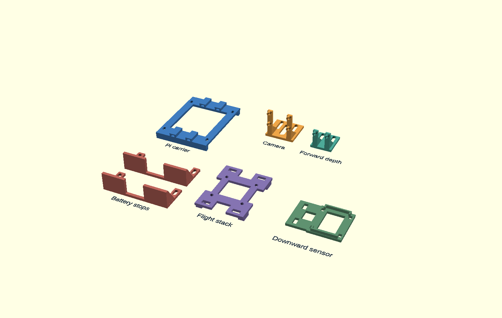

# F450 mount prototypes — 22 September 2026

**Receipt update, September 24:** owner reports the Amazon PETG filament received; no print or physical fit result has yet been reported. The earlier PETG-unconfirmed statement below is historical.

The first coordinated set of six CAD files (seven printed pieces) is modeled, compiled to STL and visually inspected. **[Sliced projects and first-print instructions](print-prep/README.md)** are now available: six OrcaSlicer projects with checked layers and corrected supports. These are **fit prototypes**, not flight-qualified parts. No more owner dimensions were required. PETG receipt remains unconfirmed; nothing has been printed, installed, load-tested or thermally qualified.

| Part | CAD | Prototype mesh | Solid PETG estimate |
| --- | --- | --- | ---: |
| Revised Pi carrier, including underside nut clearance | [SCAD](pi-carrier-core-draft.scad) | [STL](pi-carrier-core-draft.stl) | 11.35 g |
| Camera Module 3 bracket | [SCAD](camera-bracket.scad) | [STL](camera-bracket.stl) | 3.89 g |
| Forward depth sensor bracket | [SCAD](forward-depth-bracket.scad) | [STL](forward-depth-bracket.stl) | 2.85 g |
| Two adjustable battery end stops | [SCAD](battery-end-stops.scad) | [STL](battery-end-stops.stl) | 9.21 g |
| Original MicoAir743 stack adapter | [SCAD](electronics-stack-adapter.scad) | [STL](electronics-stack-adapter.stl) | 6.96 g |
| Downward MTF-01P support | [SCAD](electronics-flow-support.scad) | [STL](electronics-flow-support.stl) | 4.46 g |
| **Total modeled plastic** | | | **38.72 g** |

Mass uses closed-mesh volume and 1.3 g/cm³ PETG, not a slicer or scale. It excludes supports/waste, fasteners, ties, electronics and unmodeled parts. Only **1.28 g** remains within the prior 40 g aircraft print allocation; extra printed lamp/harness mounts need further lightening or an explicit aircraft mass-budget recalculation. Do not call this a complete flight-mount package.

## Arrangement and evidence

[Reference assembly view](mount-assembly-reference.png) uses approximate translucent frame surfaces and component boxes, not a reconstruction of the received plate or cooler. Coordinates: X right, Y forward between red arms, Z0 at top of lower plate. The current proposal places Pi above center, stack between plates, camera/depth at lower front, battery below center, and flow sensor to the right below the plate. Frame plate thickness 2 mm in that picture is an assumption; the owner supplied only approximately 38 mm interplate gap and 98 mm top-plate center spans.

Broad contact feet, flexible lashing routes and slots replace precision frame-hole matching. This reduces measurement dependence; it does not excuse unsupported feet, slipping ties, sharp edges or routing over electrical joints. Battery stop ties need anchors on opposed sides. The required routes remain assembly hypotheses until fitted to the actual frame.

Primary sources and exact component interfaces are in [Pi notes](pi-carrier-core-draft.md), [camera/depth notes](camera-design.md), [battery notes](battery-design.md) and [electronics notes](electronics-design.md). Original project CAD uses no imported third-party CAD library. OpenSCAD 2021.01 was used because this session had no callable Fusion connection; source remains editable, STL is a mesh export.

## Verification completed

- All six STL files compile from their SCAD sources. [Reproducible mesh checks](check_mount_meshes.py) pass closed edges, consistent triangle winding, positive volume and expected connected-part counts; [results](mount-mesh-checks.json).
- All individual renders and the combined display were visually inspected. The display layout is not a slicer plate.
- Independent review found and corrected missing Pi-standoff clearance. The carrier now has 4.5 mm underside clearance and bearing rails spaced away from the nut corners. Its earlier 8.68 g / 5.7 mm-high version is superseded.
- [Layout calculation](check_layout_clearances.py) screens the declared component/wire envelopes against a square-X 450 mm wheelbase and 240 mm prop disks. Minimum nominal plan-view clearance is **23.72 mm** at the front sensors, above the project's 20 mm target. These are rigid reference envelopes, not evidence of actual prop height, flex or restrained-wire placement.
- The conservative downward optical cone calculation leaves **6.72 mm** beside the maximum battery body at its lower edge. Landing legs, straps, shiny surfaces and real sensor performance remain outside that calculation.

## Hardware and limits found before printing

1. **Camera/depth fasteners:** six M2 screws and nuts are needed; M2×10 with compact heads is the current trial length. Purchased M2.5 screws must not be forced into these boards. No purchase made.
2. **Flow-sensor retention:** revised to a shallow case cradle and two already-ordered 150×3 mm ties. The documented corner holes contain case screws, so the earlier assumption of empty mounting ears is withdrawn. No new sensor screws are specified. Keep tie bands clear of optics and the connector during installation.
3. **Stack bolts:** select four **M3×25 mm** as the prototype design length. The supplied two 8 mm sleeves per screw, 2.5 mm adapter, 4 mm nut allowance and 1 mm exposed thread require about 23.5 mm; 25 mm leaves 1.5 mm reserve and about 9.5 mm upper-plate clearance. See [assumptions and engagement limits](electronics-design.md). The earlier 0.5 mm excess for M3×30 was against a conservative allowance, not measured contact. No purchase or bolt cutting performed.
4. **Battery straps:** specify **two 16×300 mm** for coverage of the tallest candidate; the conservative route requires 264 mm at a 55 mm slot span, or 274 mm at 60 mm. Existing 250 mm straps remain potentially usable for a thinner pack or a verified shorter route. No purchase made; normal installation must establish at least 30 mm engaged overlap and secure tails.
5. **Printing:** sliced for the provisional X1E/0.4 mm/textured-PEI/PETG setup. Stack adapter is flipped and support-free; Pi ring uses bed supports; camera/depth have saved hole blockers and corrected supports. Digital opening checks pass. Inspect small holes, tie tunnels and bearing surfaces after physical support removal; actual lab nozzle/plate/spool confirmation remains an ordinary print setup step.

No new frame measurements are requested. At ordinary unpowered installation, combine the essential checks: all fasteners seat and engage without reaching electronics; feet bear on real plate material; ties/straps cannot slide; no battery deformation or cable pinch; stack has clearance; lenses and cooler remain open; battery/gear/prop clearance remains adequate. Follow with relevant load, vibration, optical and thermal checks before flight. Geometry and calculations cannot certify those properties.

## Remaining designs

GPS/receiver/regulator placement uses insulated supported retention where the received housing allows it; exact pressure-safe contact and harness routing are still unfinished. A bare board must not be cinched across components. The Samtec power connector's retained/insulated termination also remains part of wiring design.

Lighting remains a separate unresolved hot-part mount. The selected [HS13137 manufacturer page](https://www.ledsupply.com/led-heatsinks/heatsink-finned-with-adhesive-tape) gives approximately 35.05 × 35.05 × 18.01 mm aluminium heatsinks. A PETG clip touching an untested hot heatsink is not accepted. Metal retention/thermal separation, captive optics and powered temperature evidence must be established before a lamp bracket release. This does not block the daylight frame/flight build, but lighting remains a required later capability and its mass stays in the budget.

Next: print only the Pi-carrier fit prototype once PETG/printer access is available and the operator verifies the saved setup. Combine unpowered fit checks with upcoming component installation. Keep current working Pi desk hardware intact until that session. Files are local and uncommitted; no purchase, print or hardware actuation was performed.
