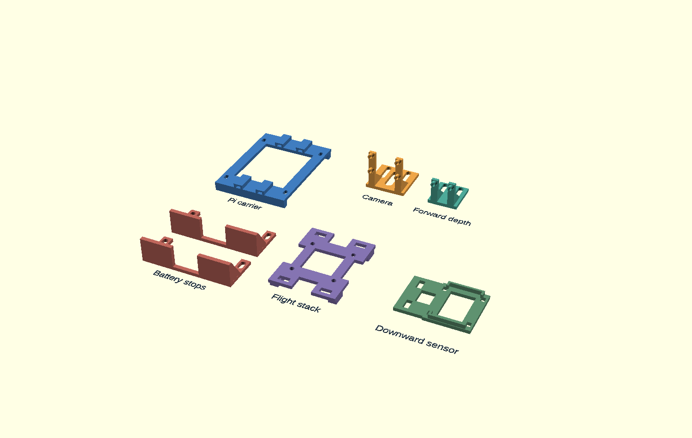

# B.G.D beginner build runbook

Prepared September 25, 2026. **Full-project deadline: September 30, 2026, 12:00 p.m. Eastern Daylight Time.** This is an instruction manual and release checklist, not a second progress log. Actual results belong in [Issue12](../../../.scratch/biometric-guard-drone/issues/12-phone-onboard-interaction.md); read [CURRENT](../../CURRENT.md) before each session. [Issue10](../../../.scratch/biometric-guard-drone/issues/10-milestone-ladder.md) controls product requirements, and the [live parts list](../../increment-1-2-bom.md) controls equipment selection.

**Readiness, September 28:** the owner reports all ordered parts received, including the flight-controller/ESC stack, GPS and flow sensor; the prints are expected September 29 morning. Four motors are mounted and the battery has been dry-fitted by owner report, but actual variant, electrical operation and printed fit are unqualified. The Pi desk demonstration works; it does not control a qualified aircraft. Start the received-stack check with the [unpowered A5 card](stack-and-motor-route-dry-fit-2026-09-28.md); use the [print intake and fit order](print-intake-fit-2026-09-29.md) when the pieces arrive. The [USB-only board baseline](micoair743-usb-baseline-2026-09-28.md) is read-only and follows identification. The [C1 power map](c1-power-map-draft-2026-09-28.md) and [C2 charging card](c2-battery-charge-draft-2026-09-28.md) are engineering drafts, **not releases** for soldering, charging or aircraft power. Never invent a missing value, substitute a similar-looking connector, or advance because the calendar says to.

## How to follow this guide

1. Read the whole current card before touching equipment. Collect its tools first.
2. Check its required power state. “Unpowered” means the flight battery, USB cables and other supplies are disconnected from the assembly being handled; a battery itself always contains energy.
3. Perform one numbered action at a time. If the observed result differs, use the stop/fix instruction and retain the failed result.
4. Record the card ID, date, exact part/version, measurements with units, and outcome. Report these in the existing project conversation; the agent updates Issue12 and the checkpoint. A photo shows appearance; it does not prove electrical performance.
5. Advance only when the exit conditions pass. A **NOT RELEASED** card is a work order for the agent, not a request for the beginner to research or design that stage.

There is no substantiated schedule for completing all remaining requirements by the mandatory deadline. The calendar at the end exposes the dependencies; it does not redefine a hover or desk demonstration as completion.

## A — Equipment and unpowered fit

### A1. Set up the bench and reconcile what is present

**Status:** available preparation. **Power:** flight battery disconnected; iron off; propellers off. **Have ready:** live parts list, packaging/labels, small containers, masking tape/marker, phone camera, clear table and the assembled frame.

1. Put the propellers in a separate labeled container. They stay off throughout assembly and electrical tests.
2. Give screws separate containers: M3×8 motor screws, frame/leg screws, M2 camera/depth screws if available, and M3×25 stack screws if available. Do not combine similar-looking sizes.
3. Compare each parcel against the live parts list. Mark the difference between “ordered,” “received,” and “inspected.” Keep model labels and included instructions with their parts.
4. Check the tool list: temperature-controlled iron with stand and suitable broad/small tips; electronics solder and flux; wick; eye protection; heat-resistant work surface; work holder; cutters and wire stripper matching the wire sizes; multimeter with intact probes; and a controlled heat source appropriate for heatshrink. Identify a way to extract solder fumes away from your breathing zone. Keep drinks/food away.
5. Check practice supplies: spare small wire, spare thick wire representative of the power harness, a practice board with copper pads, and a spare disconnected connector. They must be spare after actual harness lengths are reserved. Received RDQ wire and heatshrink should not be bought twice.
6. Check unresolved mounting supplies: six M2×10 screws/nuts, four M3×25 stack bolts, and whether the existing battery straps are long enough. These quantities/lengths are prototype selections; physical fit still decides acceptance.

**Expected:** a clear list of present and missing items, with no guessed receipts. **Stop/fix:** damaged tools, exposed probe wiring, mismatched components or missing practice material stay out of use; send the exact discrepancy for resolution. **Evidence:** inventory differences and tool model/solder-alloy labels. **Next:** A2 and A3 can proceed without soldering equipment.

### A2. Check one motor's screw fit

**Status:** available dry-fit check; remaining motors wait for the first result. **Power:** all disconnected, no propellers. **Have ready:** one SunnySky motor, one frame arm, its M3×8 screws and a properly fitting hand screwdriver/hex driver. The motor drawing specifies only 2.8 mm thread depth; the kit's screw length alone does not establish safe engagement.

1. Inspect the motor base and the arm pad. Remove loose packing debris. Keep the motor's wires free rather than trapped beneath it.
2. Rest the motor flat on the pad and align the mounting holes naturally. Do not enlarge holes or bend the arm to match them.
3. Start the mounting screws by hand through the arm into the motor. Keep the motor seated flat. Use only gentle hand pressure; stop if a screw resists before its head reaches the pad.
4. Bring the screws evenly into contact. Do not use a powered driver or force a screw that has stopped turning. No torque value has been released.
5. Gently check whether the motor base lifts or rocks relative to the arm. Turn the motor bell by hand and compare with how freely it turned before attachment. Normal magnetic steps are different from new scraping or binding.
6. Inspect for a screw reaching internal windings or other motor parts wherever visible. Lack of visible contact does not prove adequate thread engagement. The agent must check actual screw protrusion through the arm against the 2.8 mm hole-depth limit and required engagement; a firm clamp alone cannot prove either. Keep this as a trial, not final installation, until that review is complete.

**Expected:** motor base fully clamped, no gap/rocking, no new rubbing. **Stop/fix:** a screw stopping with a loose motor suggests bottoming or mismatch; poor engagement or rubbing also fails. Remove the screw and have the agent resolve screw length/washer choice from the actual assembly. Do not shorten screws or stack improvised washers. **Evidence:** side/underside view and whether each screw seated, the base clamped and bell rotation changed. **Next:** review this first fit before repeating it on the other three motors. This dry fit is not final flight fastener qualification.

### A3. Inspect and trial-position the battery without connecting it

**Status:** available dry fit. **Power:** battery connector unplugged, covered against accidental metal contact; no charger. **Have ready:** HOOVO pack, frame, straps, ruler and end-stop prototypes if available.

1. Read the actual pack label. The ordered item was HOOVO 4S, 14.8 V, 6200 mAh, 80C hard case, EC5 connector. Record any difference rather than assuming the listing is the pack.
2. Inspect case, seams, cables and connectors for damage, swelling or exposed conductors. Do not insert tools into connectors or measure current across the battery with a meter.
3. Trial-position the pack centrally below the lower plate on a nonabrasive insulating support. Keep the cable exit free of a sharp bend. Support the pack by hand during this trial; do not lift an unsecured assembly.
4. Trial-route both straps through suitable plate slots around the pack. Avoid wrapping unnecessarily around the entire plate. If fitted, end stops prevent fore/aft movement; straps provide retention. Neither replaces the other.
5. Check at least 30 mm of engaged strap overlap, secured tails, no pressure deforming the case, and no pinch on either battery lead. If existing straps cannot do this, record the shortage; two 16×300 mm straps are the current proposed replacement.
6. With the frame resting on all feet, measure the lowest battery/retention point to the table. The project's preliminary static ground-clearance criterion is at least 30 mm; gear flex still needs later review. Photograph the route and clearance.

**Expected:** undamaged matching pack, viable secure route, connectors accessible, adequate ground clearance. **Stop/fix:** damage means no charging/connection; a poor route or clearance means mount/strap redesign. Do not force the pack between parts. **Evidence:** label/connector images, measured clearance and strap overlap. **Next:** A4 when the carrier is available. Charging is a separate unreleased card.

### A4. Check the first printed Pi carrier

**Status:** available only after the owner supplies a cooled, support-cleaned print. **Power:** carrier/frame unpowered; preserve the working Pi desk setup. **Have ready:** current Pi carrier, four Pololu M2.5 standoffs/nuts, four RDQ 150×3 mm ties and frame. Follow the [current carrier notes](../f450/pi-carrier-core-draft.md); older flat-bottom carrier renders are superseded.

1. Inspect for cracks, separated layers, warped bearing rails, blocked slots and support remnants. Use normal supervised lab support-removal methods; do not cut toward your hand.
2. Pass a loose tie through each of the four tunnels without tightening it. It should slide through without force or damaging the tunnel roof.
3. Trial-fit the four standoffs to the carrier mounting slots, with their nuts below the carrier. Check that nuts and protruding threads remain above the plane on which the bearing rails sit.
4. Rest the bearing rails on solid material of the top plate. Check that the carrier does not rock and that each rail is supported, rather than bridging an opening.
5. Lay out the tie route: through a carrier tunnel, down a frame slot, underneath a solid plate strip and back through another slot. Buckle heads belong below the frame, clear of electronics and cables. Do not tighten across an unsupported gap.
6. Record any obstruction to the future Pi board, cooler, camera ribbon or GPIO socket. Do not dismantle the live desk Pi simply to complete this first empty-carrier check.

**Expected:** clean intact carrier, clear tunnels, supported rails and accessible attachment route. **Stop/fix:** blocked routes, standoff contact with frame, cracking or rocking require correction/reprint review. Do not fly a prototype because its digital mesh passed. **Evidence:** carrier underside/top and frame trial-position views, plus any interference. **Next:** agent reviews the first fit before relying on remaining prints.

### A5. Stage the remaining mounts and incoming electronics

**Status:** identification and unpowered layout only; final installation awaits exact-part review. **Power:** all disconnected, props off. **Have ready:** [mount reference](../f450/README.md), received parts and labeled fasteners.

**Received-stack starting card:** [identify the original FC/50 A ESC and dry-fit one motor route without cutting](stack-and-motor-route-dry-fit-2026-09-28.md). Follow one check at a time. Its trial position must be repeated with the actual stack print before any motor-lead cut.

[Open the proposed assembly arrangement](../f450/mount-assembly-reference.png). The translucent frame/component outlines in that image are approximate design references, not a verified photograph of your assembly.

1. Match each print to its name: camera bracket, forward-depth bracket, two battery stops, stack adapter and downward-flow support.
2. Keep camera/depth M2 fasteners separate from M2.5 parts. Do not force a larger screw into a board hole.
3. Identify the stack's supplied sleeves and boards when they arrive. M3×25 is the prototype bolt selection; do not tighten an unfamiliar stack before its assembly order and clearance are reviewed.
4. Identify the downward sensor's intact case and optical openings. Its design uses two ties; do not remove case screws as though they were spare mounting holes.
5. Set GPS, receiver and regulator beside their proposed locations without tying across bare components. Record label revisions and included connectors.
6. Keep lamps, optics and metal heatsinks together. Lamp retention and heat separation remain unfinished. Do not attach a hot heatsink directly to a PETG bracket.
7. Lay wires along plausible routes without cutting them. Reserve bend room, connector access and tie locations. Keep all routes out of future propeller sweep and away from sharp plate edges.

**Expected:** parts identified and mismatches visible before irreversible assembly. **Stop/fix:** unfamiliar connector/pad labels or interference goes to the agent for an exact revised drawing. **Evidence:** actual board markings, included lead ends and the unpowered layout; written observations and measurements suffice for ordinary matches. Request a targeted photo only when a particular marking, termination or fit cannot be resolved from known product sources and a written observation. **Next:** B practice can run independently; C1 requires this information.

## B — Learn soldering on disposable samples

**Inventory correction, September26:** owner confirms only kit and wick received; separate multimeter and flux pen were not ordered. B1 and the measured checks in later cards await the meter. Do not imply those items arrived with the kit, or require the owner to find a nonexistent prior order. Unpowered bench setup remains available; actual heating exercises require their stated materials and instructions.

**Identified equipment, September26:** owner received the [YIHUA939D+ III EVO kit B09WQ6V6GF](https://www.amazon.com/dp/B09WQ6V6GF?th=1). Its listed package supplies the US-powered station and iron, X-2 holder/cleaning kit/dispenser, 35g lead-free solder, three assorted tips, helping hands, illuminated magnifier and manual. Do not ask the owner to identify the model again or buy those basics twice. Separate flux, meter, practice board and additional #1401 tips are not confirmed by the kit listing. Exact solder alloy and included tip shapes still need their labels/manual only if needed for the selected exercise. Initial preparation: with station unplugged, put holder on the heat-resistant work surface and park the cold iron in it; keep its cord clear of the working area. No heating until the practice materials and setup are ready.

The first session may take 60–90 minutes, but time spent is not a pass. The following sample dimensions and repetitions are learning exercises, not an aircraft harness specification. No battery terminals, flight boards or required connectors are practice material.

### B1. Learn the meter before heating the iron

**September27 latest correction:** flux and multimeter are now confirmed in hand. Owner says the requested practice/check was already done; do not automatically reassign it. Older missing-tool statements are superseded. Actual meter model/readings and flux identity are not recorded; ask only when needed for the selected procedure. C1 instructions remain unfinished.

**September27 progress:** owner reports having practiced soldering. Review the existing cooled samples and reported method before assigning more practice; this report does not establish the meter checks or B5 result. Prints are now tentatively due September28 late afternoon and Pyrodrone that morning/afternoon. No permanent aircraft joint has been released.

**Status:** preparation after meter is identified. **Power:** samples disconnected; battery away. **Have ready:** meter/manual and loose wire.

1. Read the meter's manual for continuity mode. Insert black probe in COM and red in the voltage/resistance socket, **not** the current socket. If socket labels differ, stop for model-specific help.
2. Select continuity. Touch the metal probe tips together, then separate them. Note the display and sound in both cases; some meters have no audible beep.
3. Touch opposite exposed ends of an intact loose wire. Compare with the probe-touch result. Separate wires should not behave as one connected wire unless touching.
4. Turn the meter off after the exercise. Never use continuity/resistance mode on powered equipment or across a battery.

**Expected:** you can distinguish a connected sample from an open one. **Stop/fix:** unchanged or confusing readings need mode/probe review before aircraft measurements. **Evidence:** meter model and observed open/connected readings. **Limit:** continuity cannot prove that a joint can carry motor current safely.

### B2. Set up and tin a practice wire

**Status:** release after exact iron/tip and solder alloy are identified. **Power:** only the iron powered; aircraft and samples unpowered. **Have ready:** B1 equipment, eye protection, holder, heat-resistant surface, ventilation, flux, solder, stripper, spare wire and iron stand.

1. Put the stand within easy reach, secure its cord, clear the work surface and arrange fume extraction. Wash hands after solder handling and before eating.
2. Fit the appropriate tip while the iron is cold, following its manual. Have the agent specify the initial temperature from the actual solder/iron instructions; there is no universal released setting here.
3. Cut two short disposable wire samples, only from confirmed spare stock. For this exercise expose roughly 5 mm of copper on each end. Use the stripper slot matching the wire; reject cut/missing strands and try again.
4. Hold a sample with its copper accessible and the grip away from the heated end. Apply a small amount of electronics flux according to its instructions.
5. Heat and tin the iron tip as its manual directs. Touch the tip to the copper and feed a little solder to the heated copper. Aim for a thin coating through the exposed strands, rather than a ball perched on top.
6. Remove solder, remove iron, return iron to stand and leave the sample still until cool. Inspect before touching the joint.

**Expected:** coated copper, no loose strands, no burnt insulation or huge solder bead. **Stop/fix:** if solder will not wet the copper, stop heating, cool and review tip cleanliness/contact, flux and alloy. Do not hold heat indefinitely or simply maximize temperature. **Evidence:** cooled sample close-up and iron setting/alloy. **Next:** B3 after acceptable tinning.

Technique reference: heat the work so solder spreads over the intended surfaces and let it cool without movement. [Adafruit: making a good joint](https://learn.adafruit.com/adafruit-guide-excellent-soldering/making-a-good-solder-joint).

### B3. Join two practice wires

**Status:** learning exercise after B2; not permission for a flight splice. **Power:** only iron powered. **Have ready:** two tinned samples, holder, solder/flux, meter and heatshrink sized for the sample.

1. Slide heatshrink onto one wire and park it far from the joint so it cannot shrink early.
2. Hold the two exposed tinned ends overlapping and in contact. Keep insulation out of the overlap. The holder, rather than your fingers, keeps alignment.
3. Reheat the overlap until the existing solder joins the two surfaces; add only what is needed. Remove heat and leave it motionless while cooling.
4. Inspect all sides for cracks, loose strands, an obvious unjoined surface or melted insulation. A shiny finish alone does not prove quality; some alloys cool matte.
5. Apply a gentle pull using the insulated wire portions. The joint should not move. Check continuity as in B1 and retain the result.
6. Leave the first sample uncovered for review. After review, cover the joint with heatshrink extending over sound insulation on both sides and shrink it with the selected controlled heat source. Keep batteries elsewhere; do not use an open flame.

**Expected:** secure cooled joint and continuous electrical path, then complete insulation with no protruding sharp strand. **Stop/fix:** movement, a cracked joint or exposed conductor fails. Repair a disposable sample and recheck; do not hide a defect under tubing. **Evidence:** before-insulation views and pull/meter result. **Next:** B4.

### B4. Practice a board pad and use the wick

**Status:** learning exercise after B2. **Power:** practice board disconnected; only iron powered. **Have ready:** copper-pad practice board, short spare wire/component lead, wick, flux, holder and cutters.

1. Choose a pad with clear space around it and pass the sample lead through its hole. Secure the board so it cannot move.
2. Touch the iron so it heats the pad and lead together. Feed solder into that heated meeting point until both are joined. Remove heat and cool undisturbed.
3. Examine nearby pads for an unintended solder bridge. Inspect whether copper has lifted from the board.
4. On this disposable sample, place a short fresh section of wick on the solder to remove. Heat the wick with the iron so molten solder draws into it. Do not hold near the heated braid.
5. Lift iron and wick together while the solder is molten. If it sticks after cooling, reheat gently; do not pull a stuck braid off the pad. Cool, then cut off the used section away from the board.
6. Re-form one acceptable joint and check intended continuity and separation from neighboring unconnected pads. Trim protruding leads with eye protection, controlling the offcut.

**Expected:** attached pad, joined lead, no bridges and a corrected joint. **Stop/fix:** lifted copper or repeated failure means pause and review heat transfer/technique, not stronger pulling. **Evidence:** top/bottom close-ups and meter results. [Adafruit common problems](https://learn.adafruit.com/adafruit-guide-excellent-soldering/common-problems) illustrates wetting, heat and pad damage.

### B5. Qualify the thick-wire technique and end the session

**Status:** representative practice; exact connector preparation requires its instructions. **Power:** spare connector never attached to a battery; iron only. **Have ready:** spare power-wire sample, spare identified connector, broad tip and earlier equipment.

1. Have the agent identify the connector contact/insulation and provide its preparation method. Do not substitute an aircraft-required plug because a spare is missing.
2. Support the connector so it cannot turn, then tin/join the sample using the approved preparation. Keep the wire still while cooling.
3. Inspect for incomplete wetting, loose strands, softened/displaced connector contacts and insulation damage. Check mechanical security and continuity. A small-pad success does not qualify this larger heat-demanding joint.
4. Produce three successive acceptable examples of each joint type needed next. This is the proposed project learning criterion, not a certified soldering qualification. Preserve the examples for review by the agent and, if available, an experienced person in the lab.
5. Turn the iron off and leave it secured in the stand to cool. Clear wire/solder scraps, store chemicals as labeled and wash hands.

**Expected:** repeatable acceptable samples with no heat damage. **Stop/fix:** failed thick joints require technique/tool review or hands-on assistance before power harness work. **Evidence:** sample photos, exact materials/settings and pull/continuity results. **Next:** C1 must also pass before any permanent aircraft joint.

## C — Engineering release and powered build

**September29 isolated pre-print assemblies:** [BETAFPV Nano receiver lead preparation](elrs-nano-receiver-harness-2026-09-29.md) conditionally releases its four mapped low-voltage solder joints after the actual cable/pad/route checks. [LED-star lead and heatsink preparation, revision 3](led-star-leads-2026-09-27.md) releases the two disconnected white lighting boards' marked `+`/`−` pigtail joints; a meter pass is required before bonding a checked star to its supplied taped heatsink. Neither card releases plugging the Nano into the FC, the BuckPuck, aircraft power, heatsink-to-aircraft retention or any C1 high-current harness joint. Owner reports both light-board pigtail pairs soldered and the Nano T antenna seated; neither has an electrical pass. No repeat practice assignment or routine photo is required.

The following are detailed stage contracts. They tell the beginner what will be provided, what order to follow and how completion is checked. They are **not yet executable connection, charging, firmware or flight instructions**. The agent owns preparing and validating each missing package; the owner should not need to infer pin numbers, settings or acceptable readings from prose.

### C1. Receive the final wiring package — NOT RELEASED

**Current supporting draft:** [C1 power and battery-monitor net map](c1-power-map-draft-2026-09-28.md). It resolves intended topology and source-checks key voltage/current interfaces, but lacks received-board orientation, final measured lengths, termination and meter acceptance. It does not release a joint. The isolated [GPS cable pin check](gps-cable-pin-check-2026-09-28.md) can identify a cable before connection.

**Prerequisites/tools:** A5 actual parts/route inspection and B5 practice pass; wire, connectors, insulation, meter and solder tools. **Power:** everything disconnected, props off.

**Agent must deliver:** a revision-numbered drawing showing every pin/pad from the correct viewing side; connector photos with orientation marks; wire sizes/colors/lengths; connector termination order; capacitor orientation; sensor divider; fuse position; insulation and strain relief; exact meter test points and acceptable readings; and an independent drawing-to-manufacturer check. It must explicitly resolve the GPS pin-order mismatch, competing ESC current signal, Pi GPIO socket orientation/retention and motor lead endings.

1. Compare actual labels/connectors with the drawing before cutting anything.
2. Lay out and measure each route with its bend/service allowance. Record the agreed length, then cut only that identified lead.
3. Build one named subassembly at a time in the drawing's sequence. Inspect each joint before covering it and record the completed net (electrical connection).
4. Install insulation/retention and check every specified unpowered test point. Have the agent review the completed harness evidence before any battery connection.

**Expected:** checked drawing and matching tested assembly. **Stop/fix:** any ambiguous view, unexpected wire color, missing pin label or mismatched reading stops that connection. **Evidence:** drawing revision, joint images and full measurement table. **Known architecture only:** EC5 battery path → ACS37220 sensor → ESC branch plus separately fused Matek branch, later lamp branch downstream too. This arrow sequence is not a wiring diagram.

### C2. Prepare and charge the battery — NOT RELEASED

**Current supporting draft:** [exact HOOVO/M450/ProgressiveRC first-charge card](c2-battery-charge-draft-2026-09-28.md). It cannot release charging until actual pack label/condition, lead polarity, voltage and supervised location are checked. The M450 can begin charging automatically when both battery connections match, so do not expect a guaranteed pre-start cell screen.

**Prerequisites/tools:** A3 battery inspection; received M450 charger and exact charge/balance leads; charger/battery manuals and appropriate charging location. **Power:** aircraft unplugged; charger initially off.

**Agent must deliver:** illustrated exact connector sequence, correct battery chemistry/cell selection and approved charge current for the actual pack, balance-screen expected readings, stop conditions, storage procedure and disconnect order. Verify the preassembled ProgressiveRC lead and connector polarity; it requires no speculative soldering.

1. Match pack and lead labels to the released card.
2. Set up the charging location and connect in the released order.
3. Check displayed pack/cell information against the card before starting.
4. Supervise the charge, stop for the specified abnormal readings/temperature/condition, and record its final state.
5. Disconnect/store as instructed. Never change chemistry/cell count to make a charger warning disappear.

**Expected:** balanced, correctly charged undamaged pack with recorded readings. **Stop/fix:** mismatch or charger error returns to the agent; no guessing a setting. **Evidence:** setup/settings and final per-cell readings. **Next:** C3 only after wiring review also passes.

### C3. First staged electrical power — NOT RELEASED

**Prerequisites/tools:** C1/C2 passes; meter and the released protection/test equipment. **Power:** props off; first connections follow the released power card; Pi initially disconnected from aircraft supply.

**Agent must deliver:** exact staged load sequence, test-point photos, meter mode/range, expected polarity/voltage bounds, approved first-power protection, safe disconnect procedure and heat/current stop criteria. No acceptable tolerance or load-test rating may be left for the beginner to decide.

1. Repeat the pre-power visual/short/polarity checks at the listed points after final mounting.
2. Energize only the first released subassembly and measure its listed outputs.
3. Disconnect before adding the next branch; repeat its checks.
4. Measure the BEC output and qualify it under the specified load before connecting the Pi. Never power the Pi simultaneously from USB-C and aircraft GPIO power.
5. Calibrate voltage and whole-battery current monitoring against actual instruments, then perform the specified loaded power/temperature run.

**Expected:** stable correct supplies, trustworthy monitoring and no overheating/faults. **Stop/fix:** unexpected reading, smell, smoke or heat means use the prepared disconnect procedure and diagnose unpowered. **Evidence:** test table, configuration, temperatures and duration. **Next:** C4.

### C4. Controller, radio and sensors — NOT RELEASED

**Preparation only:** the [USB-only original MicoAir743 baseline](micoair743-usb-baseline-2026-09-28.md) and [LiteRadio 4 settings baseline](literadio4-usb-baseline-2026-09-28.md) permit identity/backup reads without firmware, parameter or flight changes. Neither is a complete C4 release.

**Prerequisites/tools:** identified flight controller/radio/receiver/GPS/flow modules; supported USB lead, Windows setup software and C3 for battery-powered portions. **Power:** props off; USB-only and battery-powered sections must be labeled separately.

**Agent must deliver:** exact download/version/board target; screenshots of each setup page; baseline and final parameter files; board orientation; radio stick/switch map; bind/update steps; sensor configuration; calibration movements; expected screen responses; motor numbering/direction diagram and motor-test procedure; failsafe/Stop/takeover tests with expected behavior. Existing BOM hints such as CH6 modes are not a substitute for this card.

1. Save original versions/settings before changes.
2. Apply the validated firmware/configuration and compare displayed identities.
3. Calibrate in the released order; move only the named control or sensor and verify its response.
4. Run the released props-off motor tests individually. Confirm the physical motor matches its displayed number and direction.
5. Test arming/disarming, radio loss, low-battery handling, manual takeover and sensor failures using the released bench/simulation methods.
6. Save the final parameter file and logs. Resolve all relevant pre-arm failures; do not disable checks to meet the deadline.

**Expected:** every declared control/sensor/failsafe case behaves as specified. **Stop/fix:** unexpected motor, direction, channel or mode fails the card. **Evidence:** saved files, calibration results and test log. **Next:** C5, not autonomous phone flight.

### C5. Qualify a manually controlled aircraft — NOT RELEASED

**Prerequisites/tools:** completed electrical/controller gates, secure mounts and final mass/clearance review; competent manual pilot, suitable permitted site and weather. **Power:** initially disconnected; props fitted only at the designated flight-preparation step.

**Agent must deliver:** final mechanical/propeller orientation and retention instructions; exact preflight checklist, site/conditions limits, pilot controls/recovery rehearsal, short first-hover plan, abort triggers, landing/disarm/disconnect sequence and postflight log criteria. Physical assistance may be needed; lab access is not evidence of pilot training.

1. Rehearse controls and recovery with props off before going to the site.
2. At the site, complete the released preflight checklist and establish a clear test area.
3. Conduct only the released short manual test, then land/disarm/disconnect in its sequence.
4. Inspect fasteners, mounts, wires, battery and motors before another attempt.
5. Have the agent review vibration, power and controller logs. Correct failures and repeat only the affected test.

**Expected:** repeatable controlled hover/landing and acceptable structure/logs. **Stop/fix:** unexpected motion, pilot uncertainty, structure movement or failed logs prevents expanding the flight. **Evidence:** flight configuration, conditions, times, observations and logs. **Next:** D1. A hover passes only this intermediate stage.

## D — Phone, autonomy and complete-product acceptance

### D1. Connect real Pi telemetry and bounded flight authority — NOT RELEASED

**Have ready/power:** C5-qualified aircraft, validated UART harness and agent-supplied software; begin in simulation, then real props-off tests. **Agent deliverable:** verified physical serial mapping/levels, install/start/rollback commands, telemetry screens, timestamp/stale-link rules, command authority implementation, tested cancellation/takeover behavior and a case-by-case bench script. The existing read-only monitor cannot command flight.

1. Install the identified build using exact supplied commands.
2. Confirm the screen identifies the real vehicle and reports current, changing measurements.
3. Run supplied normal and failure cases: missing heartbeat, stale data, unauthorized/replayed command, Stop, manual takeover and reboot.
4. Save results and logs. Proceed to a bounded airborne command test only after its separate flight test card is released.

**Expected/evidence:** correct authority and telemetry with no stale or unauthorized motion; retain versioned logs. **Stop/fix:** simulation success cannot replace UART or real bench evidence.

### D2. Install and verify phone access, identity, language and video — NOT RELEASED

**Have ready/power:** owner's iPhone, paired aircraft/Pi and D1 bench setup; props off. Native phone implementation follows manual hover under current project sequencing. **Agent deliverable:** functioning native app; signing/install/renewal instructions with costs; exact pairing/enrollment/removal screens; secured persistent references and recovery; real liveness implementation; microphone/video/zoom controls; supported language/action definition and negative tests. The browser desk UI and disabled language-model experiments are not this deliverable.

1. Install the released app and pair the correct aircraft.
2. Enroll through the unlocked paired phone while landed. Test a genuine person, wrong person and the specified photo/replay spoof cases under predeclared criteria.
3. Remove an enrolled person, restart and confirm removed access stays removed. Test recovery and corrupt/missing-storage cases using the supplied script.
4. Check live video, digital zoom and phone microphone; verify acceptable measured delay.
5. Try supported single and composed requests, ambiguous requests, negation and unsupported requests. Compare the exact intended action with the confirmed interpretation.
6. Disable internet while retaining the local link; repeat essential operation and Stop tests.

**Expected/evidence:** real secure access and honest supported-language behavior on the owner's phone, with install/build IDs and privacy-safe numeric results. **Stop/fix:** a spoof acceptance, silent dropped clause, false capability or stale video fails the corresponding gate. Face matching alone is not liveness.

### D3. Implement and qualify each mission — NOT RELEASED

**Have ready/power:** D1/D2 and manual-aircraft gates; start with recorded data/simulation, then props-off bench, then separately released flights. **Agent deliverable:** actual mission software, measurable cases/tolerances and repeat counts declared before testing, sensor/separation/obstacle rules, selection confirmation, lost-target behavior, landing/energy policy and exact bounded flight cards.

1. Run selected-person follow, including description-based selection; verify identity is not silently changed after loss.
2. Run person search using the owner's or another person's face reference; record correct finds, misses and false matches.
3. Run described-object search across the declared representative objects, including unsupported/ambiguous cases.
4. Run area scout/count with coverage and duplicate-count tests. A count in one camera frame is not an area count.
5. Run supported multi-step phone requests and cancellation/takeover during each mission.
6. Advance each mission through simulation, bench and controlled flight stages only after the earlier stage passes. Record failures as failures without adjusting thresholds afterward.

**Expected/evidence:** each required mission passes its declared real-world cases and recovery tests. **Stop/fix:** target loss, uncertain localization or insufficient sensing invokes the implemented protective response, not continued guessed pursuit. Desk object tracking is not aircraft following.

### D4. Prove range, endurance and environments — NOT RELEASED

**Have ready/power:** qualified integrated configuration and mission cards; instrumented flight logs; tested pilot takeover. **Agent deliverable:** progressive range test and local-link/video criteria; useful-flight timing definitions; calibrated energy interruption/reserve policy; mass/power worksheet; repeatability plan; outdoor/interior/darkness test cards; lamp retention/optical/thermal qualification; and the applicable operating authorization/site requirements, including unresolved eventual out-of-sight cases.

1. Record full installed mass and payload; use the same identified configuration in the evidence.
2. Test working phone/video/control distance progressively toward 100 m **from the user**. Record user position separately from landing destination.
3. Measure useful mission time separately from takeoff and landing. Demonstrate at least ten useful minutes while retaining energy for protective recovery. An early protective landing can be correct behavior and still fail endurance.
4. Test bounded outdoor and large-interior cases, including obstacles and sensing loss as released. Do not infer interior operation from GPS outdoor success.
5. Install and qualify lighting only with the released thermal/retention design, then perform the bounded darkness cases. PETG temperature and sensor illumination limits must be measured.
6. Repeat the declared representative configuration enough to support the predeclared uncertainty/repeatability criteria. Report demonstrated versus estimated speed/altitude separately.

**Expected/evidence:** logged range, useful duration, recovery energy, environmental limits and repeatability. **Stop/fix:** reaching each number in incompatible configurations does not prove the complete product. Eventual out-of-sight operation remains an explicit unresolved operating case until designed and authorized.

### D5. Assemble the final handoff

**Status:** agent can prepare structure now; final sign-off waits for evidence. **Have ready:** results from all cards, actual receipts and software/configuration backups. **Power:** no aircraft actuation required.

1. Agent links each requirement below to its actual evidence and marks pass/fail/unverified.
2. Reconcile actual usable-system cost against $1,100, including the $288.22 Pi receipt, required accessories, app delivery, tax and shipping. Keep soldering tools/development allowance separate under the existing agreement; do not hide required installed equipment there.
3. Save source/build versions, firmware/parameter backups and exact app install/recovery instructions.
4. Supply the normal operating, preflight, charging/storage, Stop/takeover, maintenance and fault-recovery instructions for the final qualified configuration.
5. Prepare the required demonstration/report format once supplied. Record any remaining mandatory failure openly; a delivered report is not proof the entire product passed.

**Expected:** usable handoff with traceable results. **Evidence:** final requirement matrix, cost ledger, backups and operating guide. **Stop/fix:** missing evidence stays unverified. September 30 noon remains the deadline for the full product.

## Requirement-to-evidence map

All entries start unqualified for the integrated aircraft unless Issue12 records an actual pass. Existing desk/software evidence retains its narrower scope.

| Requirement | Cards and evidence needed |
| --- | --- |
| Self-built autonomous aircraft | A–C assembly/qualification plus D1/D3 real commands and missions |
| Natural phone goals/composed actions; clarify ambiguity and explain unsupported requests | D2/D3 actual-phone positive/negative cases |
| Follow selected person, including description selection | D3 identity/selection, follow and lost-target cases |
| Find owner/other person from face reference | D2 identity plus D3 search outcomes |
| Find described objects | D3 representative object search and ambiguity outcomes |
| Scout area and report counts/supported metrics | D3 coverage, unique-object association and count accuracy |
| Face/liveness before access; equal trusted-user abilities; landed enrollment/removal | D2 genuine/impostor/spoof, removal, restart and access tests |
| Authenticated device, recovery and independent manual takeover | C4/C5/D1/D2 negative and recovery tests |
| Phone voice, live video, digital zoom and conditional repositioning | D2 media and D3 clear-route/separation/energy cases |
| Outdoors, large interiors, darkness, eventual out-of-sight missions | D4 bounded environmental evidence and applicable authorization; unresolved cases explicit |
| Essential operation without internet | D2 local-link operation plus D3 mission cases without internet |
| Ten useful minutes excluding takeoff/landing; automatic early energy protection | C3 calibration plus D4 complete workload/recovery/repeatability logs |
| Initial 100 m working distance from user; larger range remains future work | D4 phone/control/video distance evidence |
| Fastest tested task speed appropriate to surroundings; estimate/measurement distinction | D3/D4 tested speed/altitude and sensing limits |
| Prefer backpack portability | A/D5 actual packed dimensions/mass and stated compromise; preference not invented pass threshold |
| Usable-system delivered cost no more than $1,100 | D5 actual receipts including mandatory accessories/software delivery |
| September 30, 2026 noon ET delivery | D5 dated handoff and requirement status; unfinished mandatory rows mean full deadline unmet |
| Watch/orbit/patrol optional; cargo removed | Do not spend critical-path time on these or count them as substitutes for required missions |

## Calendar: work only as gates pass

| Date | Owner's available work | Agent's necessary work | End-of-day decision |
| --- | --- | --- | --- |
| Fri Sep 25 | A1–A3; A4 if carrier arrives | Resolve tool availability; release actual-part wiring/mount work; inventory software gaps | Record missing tools/fasteners and first dry-fit failures immediately |
| Sat Sep 26 | A4/A5; B practice if tools arrive | Finish C1 drawing/test package and mechanical corrections; prepare configuration/test scripts | No aircraft soldering without drawing and representative practice pass |
| Sun Sep 27 | Finish practice and available fit checks | Review evidence and Monday exact-part checklist; prepare independent software/acceptance work | Tool/fit failure moves Monday work; do not label it ready |
| Mon Sep 28 | Inspect expected arrivals; C1 construction only after release; C2/C3 if ready | Confirm exact board/connector revisions, support wiring review, release C2–C4 instructions | Powered bench readiness is conditional, not promised |
| Tue Sep 29 | C4 and C5 only if all prerequisites pass | Review logs; then D1/native phone/integration under current sequencing | A first hover this late does not create enough planned time for all remaining software/product acceptance |
| Wed Sep 30 | Only released, qualified demonstrations and remaining bounded tests | 10 a.m. evidence review; target 11 a.m. handoff buffer; noon hard deadline | Report every mandatory unpassed requirement; do not call a partial milestone full completion |

## Plain-language glossary

| Term on a part or instruction | Meaning here |
| --- | --- |
| AWG | Wire thickness numbering; lower numbers are thicker. Match the specified size. |
| Tinning / wetting | Adding a thin solder coat / solder spreading onto the metal rather than sitting as a loose bead. |
| Flux / wick | Electronics soldering aid / copper braid that absorbs molten solder for correction. |
| Pad / bridge | Exposed board contact / unwanted solder connection between contacts. |
| Continuity / polarity | Whether an electrical path exists / which point is positive or negative. |
| Short circuit | An unintended low-resistance path, potentially connecting battery positive to negative. |
| Heatshrink / strain relief | Insulating tube shrunk over a joint / restraint preventing cable pulling or vibration from loading a joint. |
| Dry fit | Trial assembly without electrical power or permanent modification. |
| FC / ESC / BEC | Flight controller / motor power controller / regulated power supply. |
| GPIO / UART / I2C | Pi header connections / serial communications / shared sensor communications; each needs exact voltage and pin mapping. |
| LiPo / 4S / balance lead | Lithium-polymer battery / four cells in series / lead exposing individual cell connections to the correct charger. |
| Firmware / parameter | Software running on hardware / a setting used by that software. |
| Arm / disarm | Enable / disable the controller's ability to drive motors. An armed aircraft is not safe merely because motors appear still. |
| Failsafe / manual takeover | Protective response to a fault / pilot independently regaining control. |
| Telemetry / log / SITL | Reported vehicle measurements / retained event and measurement record / flight-controller simulation. |
| Liveness / face matching | Checking that a real present person is being observed / comparing appearance to a trusted reference. One does not establish the other. |
| Useful minutes / recovery reserve | Time doing the required task excluding takeoff/landing / energy protected for reaching a suitable landing and descending. |
| Released / passed | Exact instructions ready to use / actual evidence shows their exit criteria met. These are different states. |

### Start here in the next hands-on session

Consult CURRENT for completed cards before choosing work. **September26 owner report: A2/all motors mounted and A3 complete; A4 waits for prints.** Do not repeat those completed cards as routine homework. Next available preparation: place the unplugged station and iron holder on a heat-resistant ventilated work surface, park the cold iron securely, and keep battery/aircraft separate. Loose motor wires may be laid toward the center with slack and clear of screw heads/sharp edges, without cutting, soldering or final retention. The actual stack location and measured route must determine final lengths. Missing meter/flux and spare practice supplies still need resolution. The agent should continue preparing C1 while the owner handles independent physical preparation. Exact wiring, configuration and test cards remain necessary before this becomes an independently executable end-to-end manual.
