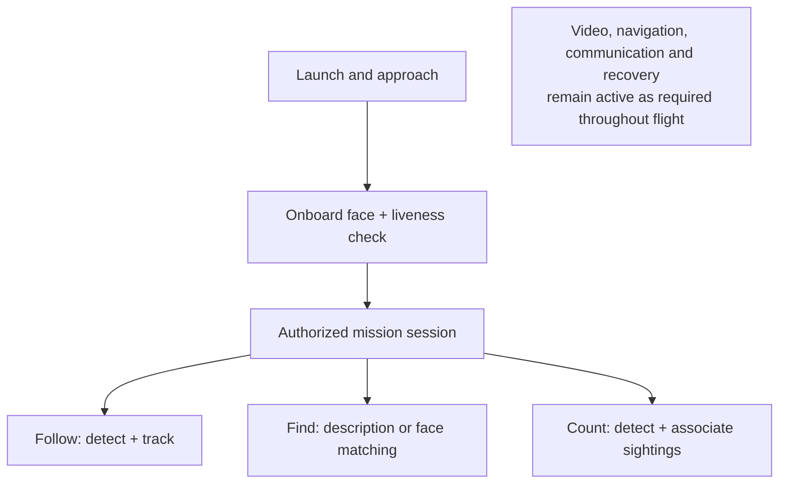

# B.G.D computing reassessment

September 15, 2026. Primary-source research plus a local component measurement. No hardware purchased or flown.

## Decision

**Keep Raspberry Pi 5 with 8 gigabytes as the preferred development candidate. Do not claim that the extra memory is required or that this board has been qualified for the complete drone.**

For a learning purchase, the 8-gigabyte Pi and Camera Module 3 are a defensible combination with a well-documented camera ecosystem. For a purchase that must deliver the complete autonomous product within $1,000, the answer remains **hold**. The corrected initial-aircraft estimate with this memory choice is about **$1,220–$1,290 delivered**, before tools and before the harder missions are fully designed.

The useful next engineering work is one representative recorded-video application on the existing computer, using the modes below. It should expose actual recognition/tracking errors and memory use before the physical Pi experiment. A limited component probe was run in this review; the complete application has not been implemented.

**Tool disclosure:** the user explicitly requested the Deep Research plugin. Its previously listed instruction file was absent, no matching callable research tool was available, and two plugin-directory searches did not return it. Consequently the named plugin was not run. This reassessment used direct primary sources, three bounded research reviews and local execution instead. No other external research service received the project files.

## What changed in the recommendation

| Earlier position | Reassessment |
|---|---|
| Choose 4 gigabytes and learn whether it is enough by buying it | Too little workload evidence supported that initial recommendation. We can investigate software and memory before purchase. |
| Eight gigabytes makes sense because the project has many features | Reasonable development headroom, but feature count is not a memory measurement. Several expensive tasks can run in different modes. |
| A small detector benchmark makes the Pi promising | True for that detector/runtime; it does not establish live streaming, face/liveness, described search and navigation together. |
| Test video, recognition and tracking together | Keep this principle, but define recognition precisely. Face-feature extraction is not liveness; fixed categories are not arbitrary descriptions; tracking identifiers are not permanent identities. |
| Passing a table test means buy the aircraft next | It advances computing evidence. The already identified budget, flight power, controller firmware and fit issues must still be resolved before that order. |

## 1. Memory: now there is an actual measurement

The local probe ran on the owner's Windows computer: Intel Core Ultra 7 255H, approximately 31.4 binary gigabytes of installed memory. The graphics processor was not used. Dependencies were installed in an isolated environment under this task's `work` directory.

It loaded and **executed all three real networks**: OpenCV Zoo YOLOX-s object detection, YuNet face detection and SFace face-feature extraction. All remained loaded while a repeated loop also performed image-point tracking and JPEG compression. Eight 1280×720 color image buffers were retained. These were public sample images, not biometric enrollment or the owner's camera.

| Measured quantity | Result |
|---|---:|
| Peak process physical working set | **453,132,288 bytes — about 0.45 decimal gigabytes** |
| Peak process private committed memory | **939,933,696 bytes — about 0.94 decimal gigabytes** |
| Eight raw color buffers | 22,118,400 bytes |
| Repeated combined component loops | 24, after warmup |
| Timed portion | 8.74 seconds |
| Execution checks | Nonempty object/face outputs, finite 128-value face feature, 100 tracked image points, successful image compression |

Physical working set is what the process had resident in memory; committed memory is backed allocation responsibility. **Do not add the two figures.** Neither is total machine memory usage. Results are recorded in `bgd-compute-measurements.json` beside this report.

**Supported conclusion:** these specific lightweight components do not inherently demand eight gigabytes. We observed no evidence of a four-gigabyte-sized allocation requirement in this probe.

**Unsupported conclusion:** that the entire drone fits four gigabytes, that the complete application peaks below one gigabyte, or that Pi speed equals this computer's speed.

The test was serial, brief and based on repeated images. It excludes real camera buffers, an actual network video stream, liveness, description-conditioned search, navigation/maps, flight transport, other processes and sustained heat/power effects. Separate services and overlapping model loading may have higher peaks. Image-point tracking under a generated two-pixel translation does not establish person tracking through occlusion. Face-feature extraction does not establish correct identity decisions.

The detector's local median was about 327 milliseconds per image; the face stages about 31 milliseconds. These are this Windows/OpenCV configuration's timings. YOLOX-s was a reproducible component reference, **not a selected flight detector or a proxy for Pi performance**. The result itself illustrates that manageable memory use can coexist with inadequate speed.

### Reproducibility

Python 3.13.12; OpenCV 4.12.0; NumPy 2.2.6; psutil 7.0.0; four OpenCV threads; processor backend explicitly selected. Model sources were pinned to OpenCV Zoo commit `47534e27c9851bb1128ccc0102f1145e27f23f98`, and every downloaded asset has a SHA-256 hash in the result file. YOLOX-s/SFace directory licenses are Apache 2.0; YuNet is MIT. The measurement does not use or claim the models' published recognition accuracy.

The reproducible scripts are `work/download_compute_probe.py` and `work/compute_memory_probe.py`; the isolated interpreter is `work/compute-check-env/Scripts/python.exe`, relative to this Codex task directory. Asset inputs and licenses are retained in `work/compute-probe-assets`. One download failed and was retried using the original project's direct image URL; the finished manifest records the assets actually used. Inference/output/hash assertions passed. No application or aircraft acceptance tests are claimed.

Primary model documentation: [YOLOX-s](https://raw.githubusercontent.com/opencv/opencv_zoo/main/models/object_detection_yolox/README.md), [YuNet](https://raw.githubusercontent.com/opencv/opencv_zoo/main/models/face_detection_yunet/README.md), [SFace](https://raw.githubusercontent.com/opencv/opencv_zoo/main/models/face_recognition_sface/README.md).

## 2. The actual workload has modes

The current product checkpoint and phone/onboard interaction contract require face identity **and** liveness to be established on the aircraft after approach to a verification position. The phone may perform speech processing, but may not declare biometric success. This assessment preserves that requirement.

| Mode | Required overlap | Work that can usually wait |
|---|---|---|
| Enrollment, landed | Camera, face/liveness, encrypted guidance and reference storage | Mission processing |
| Airborne verification | Face/liveness, preview, flight stability/navigation and recovery | Following/search/count inference until access is granted |
| Follow | Video, target tracking, periodic detection/reacquisition, navigation and recovery | Expensive description matching after acquisition, except when reacquisition needs it |
| Find | Search navigation, video, candidate detection and requested matching | Other missions; expensive semantic matching can be scheduled if the resulting behavior remains useful |
| Count | Video, detection, association of repeated sightings, count state, navigation | Description matching when the chosen counting target does not need it |
| New voice instruction | Phone-side speech/interpretation, onboard authorization and request checks | No requirement to keep a large language model permanently loaded on the aircraft |

This is an engineering scheduling proposal, not achieved performance. It preserves navigation and recovery while reducing needless inference. A state-machine transition cannot make an unimplemented navigation capability exist. Warehouse/dark/obstacle-rich operation remains a substantial, unmeasured requirement.

## 3. Concrete software choices to investigate

These are a short candidate set, not instructions to install every model simultaneously.

| Job | Candidate | Important limit |
|---|---|---|
| Camera and streaming | Raspberry Pi Picamera2, main video stream plus smaller inference stream | Pi 5 performs video encoding in software; actual encrypted phone transport and delay need implementation |
| Fast known-category detection | YOLO26n in the documented optimized NCNN format; OpenCV NanoDet as a simpler comparison | A trained category list does not cover every described target; runtime/license/version must be pinned |
| Face identity | YuNet + SFace | Does not provide liveness; thresholds and real camera accuracy need validation |
| Liveness | Original MiniFASNet implementation as an evaluation candidate | Camera/scene dependence; published demonstrations do not qualify airborne resistance to photos or replay |
| Single selected target | ViTTrack, with explicit loss/reacquisition behavior | A tracked box does not establish identity, depth, obstacle avoidance or safe flight commands |
| Counting through motion | Detector plus ByteTrack-style association and task-specific repeated-sighting handling | New track identifiers can double count an object after occlusion or revisiting |
| Described-object search | Grounding DINO as a concrete heavier reference | Processor-only support is not evidence of acceptable Pi latency; language relations and attributes can fail |
| Speech | Phone on-device recognition when its recognizer supports it | Actual phone/language support needs checking; speech supplies intent, not identity |

Sources: [Pi camera software](https://www.raspberrypi.com/documentation/computers/camera_software.html), [Ultralytics Pi guide](https://docs.ultralytics.com/guides/raspberry-pi/), [NanoDet](https://github.com/opencv/opencv_zoo/tree/main/models/object_detection_nanodet), [ViTTrack](https://github.com/opencv/opencv_zoo/tree/main/models/object_tracking_vittrack), [MiniFASNet and its limitations](https://github.com/minivision-ai/Silent-Face-Anti-Spoofing/blob/master/README_EN.md), [ByteTrack](https://github.com/ifzhang/ByteTrack), [Grounding DINO](https://github.com/IDEA-Research/GroundingDINO), [Apple on-device speech support](https://developer.apple.com/documentation/speech/sfspeechrecognizer/supportsondevicerecognition).

Descriptions such as “the red bag next to that person” need more than detecting “bag.” Likewise, counting a region requires defined handling of repeat views; it does not require inventing perfect identity across every possible environment. Those selected mission cases must be explicit before choosing the hardware to satisfy them.

## 4. What the published benchmarks actually establish

| Evidence | Useful finding | Boundary |
|---|---|---|
| Raspberry Pi specification | Four- and eight-gigabyte variants share nominal 2.4GHz four-core processor specification | Extra capacity does not add a neural accelerator or video encoder |
| Ultralytics Pi 5 benchmark | YOLO26n: 67.03 milliseconds per inference, 640-pixel input, optimized runtime, float32 | Excludes image preparation and result processing; no full application peak-memory figure |
| Arm published YOLO11n benchmark | Reported optimized peak memory 59.17 megabytes, versus 78.33 for its baseline | Memory accounting scope is not fully defined; not total application or machine memory; different model/runtime |
| Original recorded-video experiment | Approximately 7.51 processed frames/second including decoding/drawing/local writing | Not live camera-to-phone; its “inference” timer includes other work and is not directly comparable |
| Our local component probe | Three executed resident models plus buffers fit well below eight gigabytes in the measured Windows process | Not complete workload, Pi operating system, sustained flight or simultaneous services |

Sources: [Pi specifications](https://www.raspberrypi.com/products/raspberry-pi-5/), [Ultralytics measurements](https://docs.ultralytics.com/guides/raspberry-pi/), [Arm model card](https://huggingface.co/Arm/yolo11n-int8-xnnpack-executorch-raspberrypi5), [original video results](https://kadirmertabatay.github.io/rpi-yolo-benchmark/benchmarks/yolo26/yolo26n/), [video experiment source code](https://github.com/kadirmertabatay/rpi-yolo-benchmark/blob/main/scripts/benchmark_video.py).

The earlier 15-video-frame/5-detector-update/half-second-delay targets remain **provisional table-test goals**. They are not a sourced universal standard for safe following. Permissible frame age must follow the intended movement, separation and tested control behavior. For illustration, a subject moving one metre per second travels half a metre during a half-second delay. More memory cannot remove that delay by itself.

## 5. Hardware alternatives, assessed against the project

| Option | What improves | Why it is not an automatic solution | Decision now |
|---|---|---|---|
| Pi 5, 4 gigabytes | Lowest quoted complete Pi-camera bundle | Complete workload unmeasured; less development headroom | Viable comparison, not demonstrated inadequate |
| Pi 5, 8 gigabytes | More memory for services, model loading and experimentation | Same nominal processor; costs more | **Preferred development candidate**, reflecting owner's preference |
| Pi + AI HAT+ | Speeds supported vision networks on dedicated hardware | Requires compatible compiled models; does not accelerate arbitrary code or video encoding | Add only for a measured inference bottleneck with required models supported |
| Pi + AI HAT+ 2 | Supports selected small language/vision-language models as well as vision; its own memory | Extra power, heat, cost and supported-model constraints | No justification to buy now merely for memory reassurance |
| Pi + AI Camera | Some detection happens in the camera, reducing host processing | Manual focus and model-conversion constraints; does not solve the other vision/security/navigation tasks | Useful alternate branch, not a confirmed substitute for Camera Module 3 |
| Jetson Orin Nano Super | Broader accelerated-inference ecosystem | Greater cost/integration burden; different power/camera support; still software video encoding | Do not select by default for this $1,000 project |

Raspberry Pi's current AI HAT+ 2 has its own eight gigabytes; that memory is not extra general-purpose memory for the Pi. Its advertised 40 trillion operations per second use a different numerical precision from the older products. The manufacturer describes vision performance as broadly comparable to the earlier 26-trillion-operation board. Headline arithmetic rates cannot be compared as complete-application frame rates. [Official accelerator comparison](https://www.raspberrypi.com/documentation/accessories/ai-hat-plus.html), [AI HAT+ 2 explanation](https://www.raspberrypi.com/news/introducing-the-raspberry-pi-ai-hat-plus-2-generative-ai-on-raspberry-pi-5/).

Original AI HAT+ models require the appropriate Hailo compiler and model-library versions. A network working on the Pi processor does not prove that it can move unchanged onto the accelerator. [Hailo model library](https://github.com/hailo-ai/hailo_model_zoo).

The AI Camera changes the selected camera, including focus behavior. Its built-in inference does not make every supported model run concurrently or establish the authentication system. [Camera specifications](https://www.raspberrypi.com/products/ai-camera/), [deployment and conversion](https://www.raspberrypi.com/documentation/accessories/ai-camera.html).

Jetson Orin Nano has no dedicated video encoder, so video production still consumes processor resources. Its developer kit includes the carrier and cooling; an older claim that the quoted kit price excluded the carrier was incorrect. Camera Module 2 support does not establish Camera Module 3 autofocus/driver compatibility. Its flight supply must be designed separately rather than reusing the Pi's five-volt harness by assumption. [NVIDIA encoding documentation](https://docs.nvidia.com/jetson/archives/r36.4/DeveloperGuide/SD/Multimedia/SoftwareEncodeInOrinNano.html), [camera connection documentation](https://docs.nvidia.com/jetson/orin-nano-devkit/user-guide/latest/howto.html).

## 6. Corrected money comparison

Prices are September 15 snapshots. Quoted/reference merchandise below is not a final delivered or flight-ready system. Camera/ribbon prices are the previously checked $29.25 and $2.95.

| Computing route | Merchandise comparison | Availability / missing items |
|---|---:|---|
| PiShop 4-gigabyte starter kit + Camera Module 3 + ribbon | **$195.15** | Listed kit price $162.95; prior checked kit/accessory availability |
| PiShop 8-gigabyte starter kit + same camera + ribbon | **$260.15** | Kit **$227.95**, listed in stock; stock code K2B-1345-8GB |
| 4-gigabyte bundle + quoted 26-model AI HAT+ | **$327.15** | Adds SparkFun's $132 accelerator; flight mount/power still unresolved |
| 4-gigabyte kit + AI Camera + ribbon | **$235.90 reference only** | Uses $70 manufacturer camera reference; US stock/delivered quote not established |
| 4-gigabyte bundle + AI HAT+ 2 | **$325.15 reference only** | Uses $130 manufacturer reference; US stock/delivered quote not established |
| Jetson Orin Nano Super developer kit | **$399 before camera/storage/flight additions** | Current NVIDIA US listing out of stock; $249 comparisons are stale |

Price sources: [PiShop 4-gigabyte kit](https://www.pishop.us/product/raspberry-pi-5-starter-kit-4gb/), [PiShop 8-gigabyte kit](https://www.pishop.us/product/raspberry-pi-5-starter-kit-8gb/), [SparkFun 26-model accelerator](https://www.sparkfun.com/raspberry-pi-ai-hat-26-tops.html?___store=default), [NVIDIA US marketplace](https://marketplace.nvidia.com/en-us/enterprise/robotics-edge/jetson-orin-nano-super-developer-kit/). Manufacturer references are linked in the preceding section and are deliberately distinguished from store quotes.

Eight gigabytes adds **$65 before tax** to the previously checked kit. Using the same illustrative $15 shipping and six-percent tax assumptions: ($260.15 + $15) × 1.06 = **$291.66**, approximately **$292 delivered**. Actual checkout determines delivery and tax.

The full initial-aircraft reference subtotal becomes **$1,036.73 before tax**, including held/unavailable items and still missing some flight accessories. Keeping the previous $40–$70 flight-accessory and $70–$110 multi-store freight allowances gives **$1,215.53–$1,289.73**, rounded about **$1,220–$1,290**. These allowances do not price the unresolved sensing/navigation needed for the complete product. Tools remain a separate approximately $118.41 before delivery/tax under the prior agreement. No budget increase has been approved.

PiShop generally excludes change-of-mind returns. A computer working correctly but proving unsuitable for the project is not automatically faulty merchandise. [Return policy](https://support.pishop.us/article/44-whats-your-return-policy).

## 7. Concrete next step and stop conditions

**Stop comparing memory sizes as though they settle the project. Use eight gigabytes as the preferred target and implement one representative recorded-video test on the existing computer.**

1. Reuse the current command/session design. Implement camera-independent vision adapters for a known-category detector, selected-target tracker, face feature/match and bounded counting. Use recorded public/approved inputs; do not revive the retired desktop product.
2. Add representative described-target and liveness evaluations as separate modes. Show unsupported descriptions and ambiguous/failed identity cases honestly. Do not call a basic detector a completed search system.
3. Use bounded image queues and measure startup/model-switch peaks, complete service memory and frame age. Keep video/communication work active in the representative modes. Document navigation work that is still absent rather than subtracting it silently.
4. If the remaining uncertainty is actual Pi timing/camera behavior, a roughly $292 learning purchase becomes a concrete informed option. Basic arrival checks come first; the sustained camera/stream/inference test follows. A successful result qualifies only its measured conditions.

| Observed problem | Appropriate response |
|---|---|
| Memory pressure, swapping or failed allocation | Reduce unnecessary simultaneous allocation; consider more memory if the required workload still exceeds capacity |
| Slow neural inference with available memory | Smaller/optimized model or a compatible accelerator, then re-evaluate accuracy |
| Encoding/network delay | Change video pipeline and bounded queues; test the actual phone link |
| Wrong target, photo/replay acceptance or double counts | Fix/evaluate the algorithm and operating case; hardware specifications do not certify correctness |
| Missing interior/dark/obstacle navigation | Complete that sensing/navigation design and its cost/power assessment |
| Full-system cost above $1,000 | Keep aircraft purchase held; seek a credible complete alternative or an explicit owner decision about budget/scope |

## 8. Repository and evidence status

The existing simulator remains useful protocol evidence, not real perception. Issue12's checkpoint also cites `phone_drone_feasibility` and revision-r3 software design/validation files that are absent in this checkout. Those claims must be treated as historical, unreproduced evidence rather than a runnable current prototype.

This review did not rerun unchanged simulator tests or restore old applications. It measured a new isolated component probe, checked its outputs and arithmetic, and reviewed source implementations as well as benchmark headlines. No operating system was flashed, no private biometric profiles were accessed, and no supplier was contacted. Remaining limitations are stated beside the conclusions they affect.
