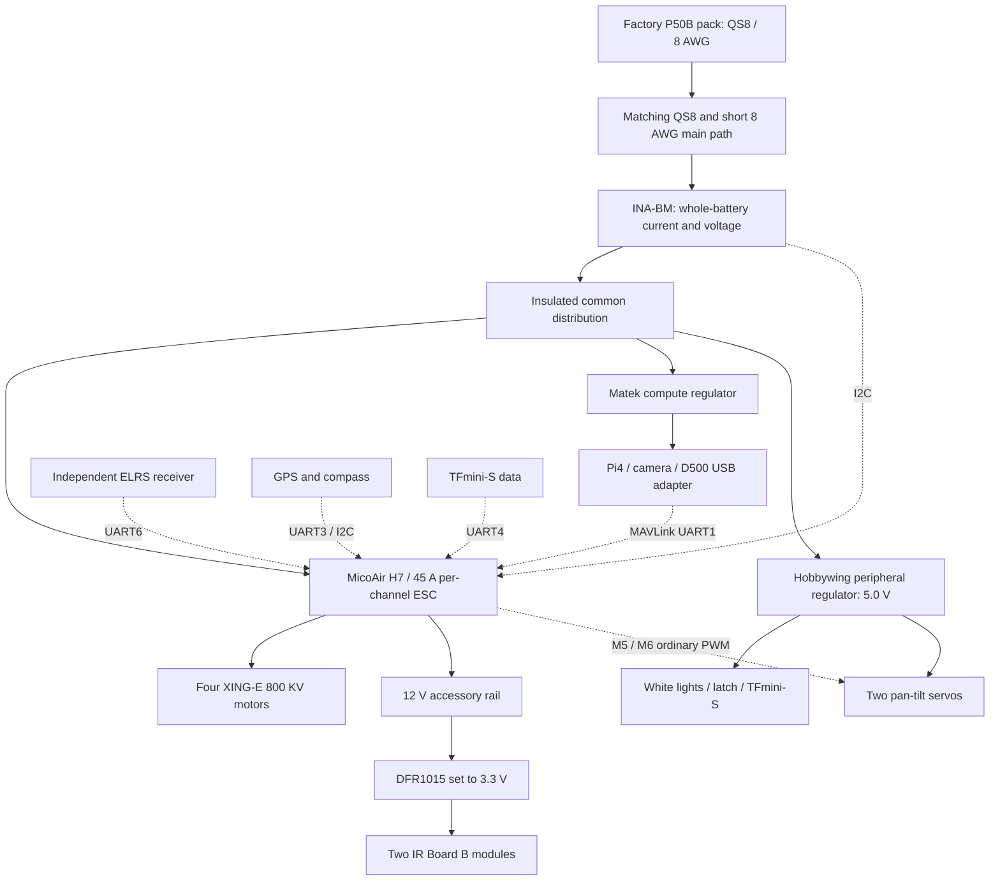

# Issue 10 — integrated layout and interfaces for the least-cost candidate

Prepared 2026-08-31 in the main checkout. **Engineering proposal, not a fabrication drawing, approved purchase or powered-operation procedure.** This document makes the current candidate's packaging, power distribution and hardware-support assumptions explicit. It accompanies the [power-path report](least-cost-power-path-2026-08-31.md), [propulsion model](least-cost-propulsion-2026-08-31.md) and [complete cost ledger](least-cost-bom-2026-08-31.md). Q1–Q74 remain authoritative; no PC implementation occurs here.

## Configuration being integrated

Source One V6 seven-inch DC; XING-E 2809 **800KV**; APC 7×4E/EP matched counter-rotating two-blade set; MicoAir743v2-AIO45A; factory Nexus 6S2P P50B/QS8/8AWG pack; upstream INA-BM; separate compute/peripheral regulators. Pi4 2GB, Camera Module3 NoIR, Adafruit1967 pan/tilt, D500, TFmini-S, IR/visible lighting and the removable recipient-verified cargo holder remain. The Pi uses the lighter fan/heatsink/insulating-guard assembly below. No sensor coverage or requested feature is deleted for a cheaper price.

The final reference mass is **1,897.251g**, including a 930g configured-pack allowance, 70g main power path, 100g remaining structural/local-harness allowance, 50g unallocated integration contingency and 8g IR subregulator/mount allowance. The earlier 1,974.251g draft is superseded by **35g less compute housing/cooling mass and 42g less pan/tilt mass**, with both functions retained. These are design allocations, not measured weights. The 250g cargo and provisional 170g removable holder add 420g for **2,317.251g** delivery mass. Purchase quantities and airborne quantities differ: one spare prop set, charge adapter and spare capacitor stay on the ground.

## Actual frame geometry checked from manufacturer CAD

The manufacturer's [7-inch DC DXF](https://github.com/tbs-trappy/source_one/blob/master/So1-V6-7inDC-2025-JUL-07.dxf) contains a two-dimensional assembled plan as well as separate parts and 3D entities. Its planar circles and hole locations were parsed and visually checked; a generic square-X layout was not substituted.

For the following coordinates, `s` is forward along the body and `r` is right, in millimetres. The origin is the centre of the CAD's large reference circle, **not an assertion about the final centre of gravity**. Transform from the source drawing is `r = DXF_x − 1518.565263306285`, `s = 1461.258462156818 − DXF_y`.

| Motor | s, mm | r, mm |
|---|---:|---:|
| Front left | 58.104 | −145.223 |
| Front right | 58.104 | 145.223 |
| Rear left | −123.357 | −96.170 |
| Rear right | −123.357 | 96.170 |

The rotor-centre centroid is **s = −32.626mm, r = 0**. The 30.5mm mounting-hole square is centred at approximately **s = 27.845mm, r = 0**. These are different positions. Centre-of-gravity adjustment must follow the rotor geometry; placing the battery over the flight controller by habit does not establish equal hover loads.

With nominal **177.8mm APC diameter**, the closest fore/aft propeller disks have about **10.17mm planar edge clearance**; the rear pair has about **14.54mm**. These are static geometric gaps, before manufacturing tolerances, motor positioning, blade flex and installation. They do not certify dynamic clearance. The CAD's larger 182mm circles are not substituted for the selected propeller diameter. Exact prop hub, mounting screw engagement and motor clearance still follow their manufacturer drawings and received-part inspection.

## Proposed installed envelope

The table is a packaging solution to detail, with dimensional allowances where no final fabricated part exists. Heights are relative to the **actual rotor disk plane**, defined as `z = 0`; establish that plane from the selected motor/hub in the fabrication drawing. It is not an instruction to install unmeasured components at guessed heights.

| Assembly | Proposed location / reserved envelope | Design consequence |
|---|---|---|
| Factory pack | 139×48×72mm nominal, fore/aft adjustment centred roughly s=−65mm; orientation with factory cable exits toward the main connection | Its plan overlaps portions of the rear swept disks, so the **pack bottom and retained cradle must remain at least 15mm above the rotor plane**, after predicted flex/clearance allowances are reviewed. It cannot simply sit between the motors at rotor height. |
| Battery cradle | Approximately 170×55mm supported platform using existing frame attachment locations; adjustment range and retention detailed before fabrication | Front/rear restraint plus independent straps; no adhesive-only attachment, unsupported cell crushing or drilling new carbon holes assumed. Verify overhang/bending and strap clearance. Material/fasteners are costed fabrication work. |
| AIO and adapter | 25.5mm board pattern adapted to the existing 30.5mm pattern, centred at s≈27.845mm | The model assigns 10g board +10g adapter/installation. Vibration isolation and connector access must fit between actual plates; no new hole pattern in the frame is assumed. |
| QS8 and INA-BM | Connector bay approximately 35×28×14mm near the pack's forward end; sensor 27×20×6mm on an insulated, strain-relieved support | Reserve mating/bend access. The combined positive/negative aircraft main conductors have a 0.20m design allowance, not a requirement to tension a wire. The factory pack is not opened or modified. |
| Pi/cooling/guard | Beneath the central frame, near s=−25mm; reserve approximately 100×75×45mm at z≈−40 to−85mm | Retain Pi4 2GB performance, a powered fan and heatsink, with the calculated insulating base/vented guard below. Keep USB/CSI access; no Pi structure enters the propeller plane. |
| Removable secure holder | Centre near s=−33mm; provisional 100×70×60mm packaging envelope below the Pi, at z≈−95 to−155mm | This proposes aircraft packaging, **not a newly approved cargo-size limit**. The final M5 enclosure/door geometry must retain cargo when detached. Mechanical retention carries the load; the solenoid only releases a latch. |
| Landing supports | Ground-contact plane approximately z=−175mm, supports outside the holder/removal path | Reserve about 20mm holder-to-ground clearance in this initial layout. Test tip-over, flex, uneven ground and collection access; never use the cargo door as the landing support. |
| Camera/pan-tilt | Forward of the body, near s=+105mm, with its entire sweep below the scanner plane and clear of props/legs/holder | Adafruit1967 is 37g assembled with two servos; add a 3g Camera3 carrier allowance. Its 38×36mm platform can accommodate the camera's 25×24mm board footprint; holes and ribbon bend still need a carrier drawing. Reserve about 70×70×80mm for the mechanism and sweep, with camera travel limited by actual clearance rather than assumed 180° movement. |
| D500 scanner | Elevated near s=+35mm, beam plane roughly z=+115mm; no pack, camera sweep or antenna mast may cross that plane | A top mast is explicit mass/cost, not free clearance. Elevation avoids self-occlusion in the planar drawing; it does not create vertical or wire-detection coverage. |
| GNSS/compass | Rearward elevated support, approximately s=−100mm, top kept below the LiDAR plane | Separate from high-current conductors and the main battery connection. Exact magnetic/RF performance remains a bench/range gate. |
| Downward TFmini-S | Unobstructed downward view outside the holder/landing-support footprint | A downward distance point does not classify safe ground. Do not allow the detachable holder to cover it. |

This packaging is roughly **0.30m tall** with landing supports. It must not inherit the drag of a bare racing frame. The propulsion report therefore retains installation-loss/mass sensitivity and a measured power budget for the twenty-minute requirement. Battery fore/aft positioning is finalized using the completed mass-moment ledger and then measured balance; the values above are not a certified CG envelope. The 100g structural/local-harness target includes the cradle, landing supports, masts, straps, permanent holder interface and small harnesses. If the actual design needs more, add it explicitly and recompute rather than hide it in a different subsystem.

### Concrete lighter compute assembly

The final **70g compute assembly** comprises a 48g Pi allowance (manufacturer-publication 46g plus 2g revision allowance), Adafruit3368 fan **6.2g**, Adafruit3082 heatsink **3.6g**, microSD **1g**, and **11.2g** for an insulating base, vented guard, standoffs and short local wiring. This replaces the broad 105g stock-case/fan/SD allocation; it does not remove cooling, protection or compute capacity. The 32GB card must pass the actual OS/model/application/storage budget; unlimited onboard recording was never approved.

A concrete guard volume check uses a 100×65×0.6mm polycarbonate base (3.9cm³, approximately 4.68g at 1.2g/cm³), two 85×8×1.2mm rails (approximately 1.96g), and a 30×40×0.8mm fan bridge before vents (approximately 1.15g). That leaves about 3.41g for nylon standoffs, fasteners and short leads. This is a fabrication target requiring stiffness, insulation, retention and airflow review, not an already manufactured or waterproof enclosure. The complete ledger adds **$15 fabrication allowance** and does not assume an owned printer or free machining. Aircraft attachment beyond this local guard remains in the existing structural allowance; no item may be counted twice. [Pi manufacturer publication](https://magazine.raspberrypi.com/articles/raspberry-pi-4-specs-benchmarks), [fan](https://www.adafruit.com/product/3368), [heatsink](https://www.adafruit.com/product/3082), [polycarbonate density](https://www.sabic.com/en/Images/Polymers-All-Products_tcm1010-42650.pdf).

The [pan/tilt supplement](least-cost-pan-tilt-supplement-2026-08-31.md) documents the other 42g saving and its price, camera fit and free controller outputs. Neither saving spends the 50g contingency or the configured-pack uncertainty allowance. Cooling and image stability must still be proven on the complete workload; a failed thermal test requires a real redesign and revised mass/cost, not silent processor throttling below required performance.

## Power and data topology

All load inputs are downstream of the INA shunt, including the FC's accessory rails. Do not sum the AIO's secondary current reading with the upstream reading. The sensor measures energy; it is not a hard current cutoff. No XT60, small signal connector, thin supplied pigtail or unknown power-distribution board remains in series with the main flight current. The low-current ground charge adapter remains separate and marked charge-only.

Use common signal references, insulated supports and load drivers. The final Adafruit kit has **no Pi HAT or extra PWM board**: its two servo signals use the FC's M5/M6 ordinary PWM outputs, with servo power from the separate 5.0V peripheral supply and shared signal ground. M5/PB1 and M6/PB0 share TIM3, distinct from the four propulsion outputs on TIM1; preserve that separation when choosing output protocols. The companion requests camera angles through the reviewed MAVLink gimbal interface. No servo output may be configured as a propulsion output or bypass the motor-arming policy. Actual pad location, output functions, pulse range and failsafe state belong in the aircraft specification. D500's USB adapter is powered from the Pi's USB allocation; its current is counted in the compute regulator, not counted again as an independent peripheral source. See the [documented controller/gimbal support](least-cost-pan-tilt-supplement-2026-08-31.md).

IR Board B is a **3.3V accessory**, not a load to connect blindly to the Camera3 mounting holes or the 5V rail. The proposed DFR1015 requires at least 7.5V input, so it receives the MicoAir's regulated 12V output and is configured for 3.3V; it cannot be driven from the Hobbywing 5V output. The two nominal 3W IR modules need roughly 6W output. Allow conversion losses and verify the FC 12V/2A and subregulator ratings; no unexplained 6S direct input above the regulator's recommended 24V is used. Their additional 8g installation is in the mass ledger. [Paired camera's 3.3V accessory evidence](https://www.waveshare.com/product/raspberry-pi/rpi-camera-f.htm), [DFR1015](https://www.dfrobot.com/product-2599.html), [MicoAir board](https://micoair.com/flightcontroller_micoair743v2_aio_45a/).

The complete worst-case auxiliary **battery-input** allowance is 4A, shared across every load and conversion loss. This is distinct from each regulated output's current and the daylight mission's average electronics power. Each rail's coincident servo stall, white-light, latch, compute/USB and IR cases must fit its own rating. Daylight IR-off accounting does not permit a nighttime rail overload. If actual servo stall or boot demand exceeds a proposed allocation, revise the power branch or supported actuation scheduling before use, without weakening independent radio control or the recipient-release policy.

## Firmware hardware support checked now

The public stable MicoAir743v2 build checked 2026-08-31 reports **ArduCopter V4.7.0**, commit `1511f27194f1dcc3728270883047bdf022b3fd53`. Its feature manifest enables `AP_BATTERY_INA2XX_ENABLED`, `AP_COMPASS_IST8310_ENABLED`, `AP_RCPROTOCOL_CRSF_ENABLED`, `AP_SCRIPTING_ENABLED`, **`HAL_MOUNT_SERVO_ENABLED`**, TFmini rangefinder support and MAVLink signing. This supplies a concrete support baseline for the named hardware and direct servo-gimbal path; it does not establish a working all-arming biometric gate, safe parameter set or authorization bypass resistance. DDS is not enabled in this stock build and is not silently required by the UART/MAVLink topology. [Version](https://firmware.ardupilot.org/Copter/stable/MicoAir743v2/git-version.txt), [feature manifest](https://firmware.ardupilot.org/Copter/stable/MicoAir743v2/features.txt).

Retain the paper-reviewed serial allocation: Pi UART1, GNSS UART3, downward ranger UART4, independent ELRS UART6; the scanner uses Pi USB and pan/tilt uses FC PWM5/6. The INA's documented default I2C address is **0x45 (69 decimal)**, distinct from the IST8310 driver's **0x0E** default. This is a paper address allocation, not discovery of the received devices: verify the selected GNSS revision, address straps and firmware parameters before integration. Freeze the actual board revision, release artifact/hash, wiring and battery-monitor loss behavior in the aircraft specification. No firmware has been installed or parameters uploaded by this task. [INA manufacturer](https://www.mateksys.com/?portfolio=i2c-ina-bm), [IST8310 driver at the inspected firmware commit](https://raw.githubusercontent.com/ArduPilot/ardupilot/1511f27194f1dcc3728270883047bdf022b3fd53/libraries/AP_Compass/AP_Compass_IST8310.h).

## What this resolves and what remains

- **Resolved as a design proposal:** real deadcat geometry, nominal propeller spacing, a specific elevated-pack/below-frame-compute layout, explicit structural allowances, a non-XT60 main current path, total-energy measurement, isolated regulator topology and a firmware support baseline. These are more concrete than a generic future-fit note.
- **Remaining specification work after candidate acceptance:** fabrication-ready cradle/adapter/leg drawings and fastener/material choices; exact connector-pad placement/strain relief; rail protection and fault table; measured-instrument plan; configuration-specific CG/thermal/voltage acceptance bounds. No feature can be enabled with an unresolved safety-critical detail.
- **Pending physical validation:** dynamic prop clearance, workmanship, mounting strength, balance, cooling, interference, current/voltage calibration, cell/pack temperatures, usable energy, Q73/Q74 outcomes, camera/phone/biometric performance, sensing/landing/night behavior and loaded holder/release tests. These results do not need to exist to review this paper configuration.

## Provenance

New uncommitted report in the shared main checkout, base `68e00796f56d1975b05efa8e8f3c5c5fd504b6ac`; that commit does not contain it. Manufacturer DXF SHA-256 `398556CD5F8720AC1A39B79BD1A0D1C083C6C57DEF55920BC17B212061B6D099` was parsed read-only; a temporary preview was visually inspected. Coordinate-derived gaps are calculations, not measured parts. Product/firmware sources were checked on the stated date, with remaining integration allowances supplied by the coordinated reports. No code, PC tickets, supplier messages, purchases, captures or powered hardware were changed.
